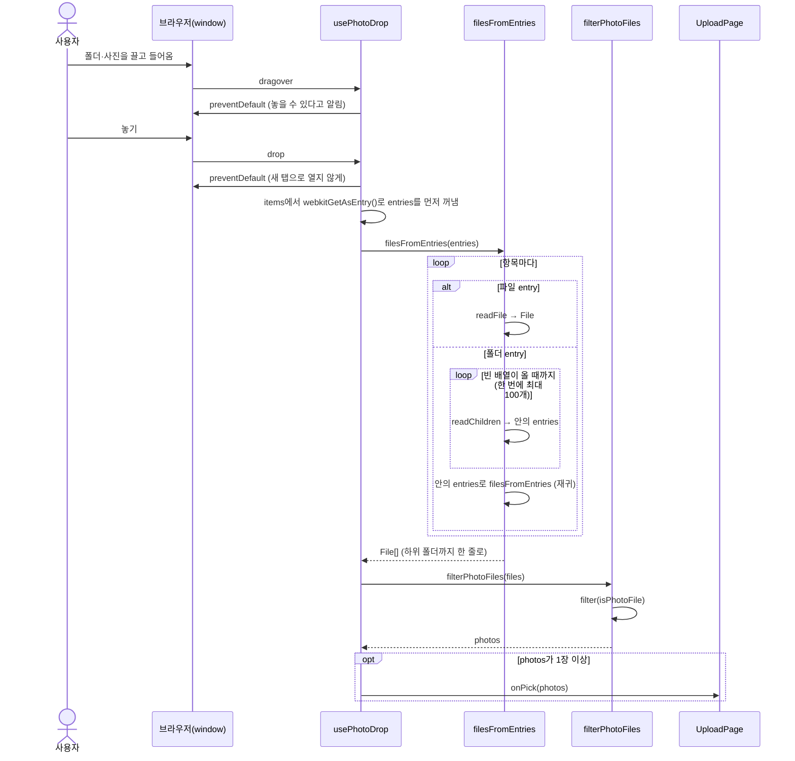
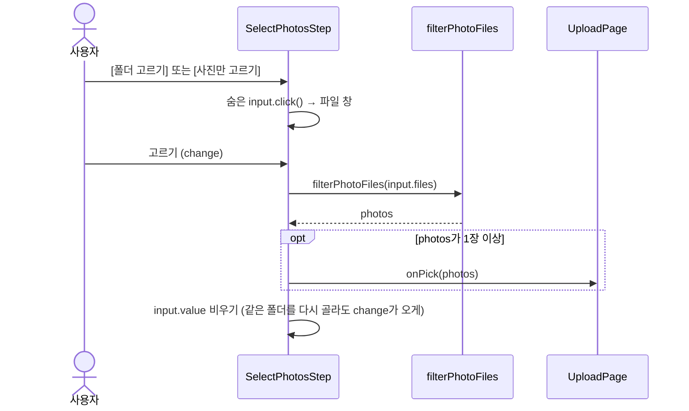

# 사진 고르기 흐름 (13a″)

사진은 [폴더 고르기]·[사진만 고르기] 버튼과 화면에 끌어다 놓기(#51), 세 가지 길로 들어옵니다. 세 길 모두 `filterPhotoFiles`로 같은 거르기를 거쳐 `onPick` 하나로 나갑니다.

## 끌어다 놓기

## 버튼으로 고르기

브라우저가 폴더를 이미 편 `input.files`를 주기 때문에 펴기 단계가 없습니다.

## 코드만 봐서는 알기 어려운 것

- **window에 붙인 이유**: 화면 어디에 놓아도 받아야 해서입니다. `<main>`에만 달면 Nav 위에 놓았을 때 브라우저가 사진을 새 탭으로 엽니다.
- **entries를 먼저 꺼내는 이유**: `dataTransfer.items`는 drop 핸들러가 첫 `await`를 만나면 비워집니다.
- **`readEntries`를 반복하는 이유**: Chrome은 폴더 안 항목을 한 번에 최대 100개만 줍니다. 한 번만 읽으면 에러 없이 100장에서 멈춥니다.
- **거르기는 이름만 봅니다**: 확장자만 jpg인 깨진 파일(`16_not-an-image.jpg`)도 통과하고, 다음 단계(`readExif`)에서 걸러집니다.
