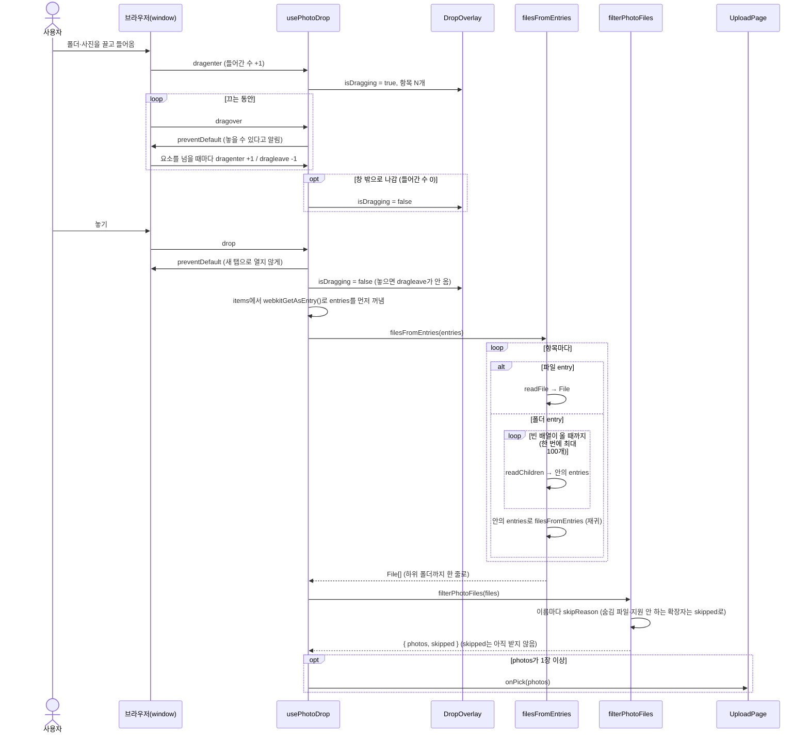
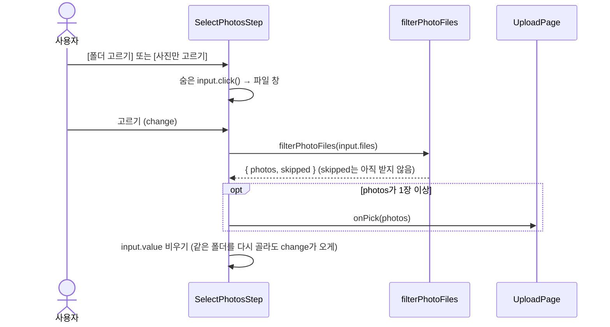
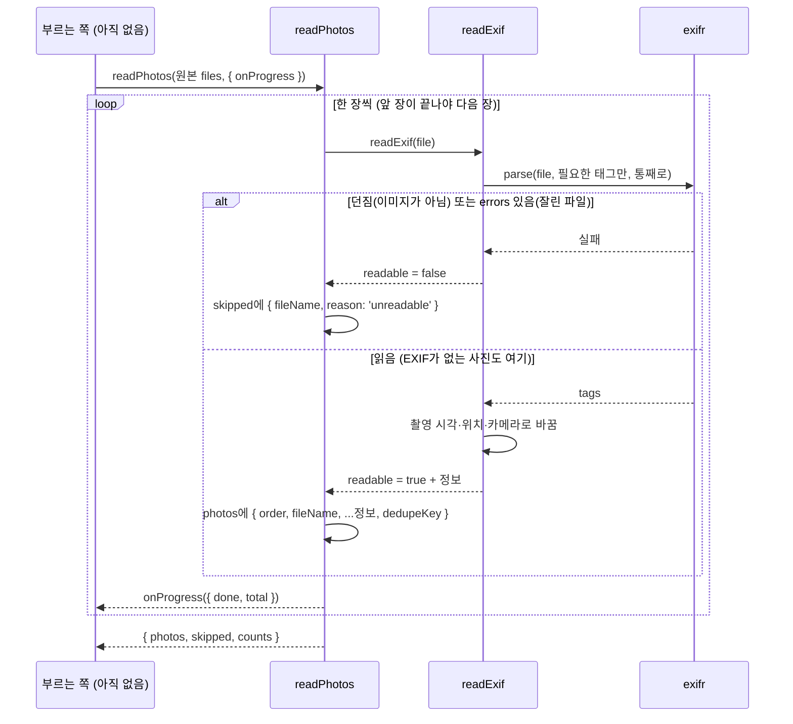

# 사진 고르기·읽기 흐름 (13a″)

사진은 [폴더 고르기]·[사진만 고르기] 버튼과 화면에 끌어다 놓기(#51), 세 가지 길로 들어옵니다. 세 길 모두 `filterPhotoFiles`로 같은 거르기를 거쳐 `onPick` 하나로 나갑니다.

## 끌어다 놓기

## 버튼으로 고르기

브라우저가 폴더를 이미 편 `input.files`를 주기 때문에 펴기 단계가 없습니다.

## 촬영 정보 읽기

고른 원본은 `readPhotos`가 한 장씩 읽습니다. 아직 화면에서 부르는 곳이 없어서 부르는 쪽은 정해지지 않았습니다.

## 코드만 봐서는 알기 어려운 것

- **window에 붙인 이유**: 덮개 문구가 "화면 아무 곳에나 놓아 주세요"라서 Nav 위에 놓아도 받아야 합니다. `<main>`에만 달면 Nav 위에 놓았을 때 브라우저가 사진을 새 탭으로 엽니다. 덮개 자체는 피그마대로 Nav 아래만 덮습니다.
- **들어간 수를 세는 이유**: `dragenter`·`dragleave`는 요소를 하나 넘을 때마다 옵니다. `dragleave`만 보고 덮개를 끄면 버튼 위를 지날 때마다 깜빡여서, 들어간 수가 0이 될 때만 창 밖으로 나갔다고 봅니다.
- **`dragover` + 타이머 방식은 쓰지 않음**: `dragover`는 "아직 끄는 중"만 알려 주고 "멈췄다"는 신호가 없어서, 일정 시간 안 오면 끄는 방식도 가능합니다. 하지만 마우스를 멈추면 `dragover`가 수백 ms 간격으로 와서 0.4초쯤 기다려야 깜빡이지 않고, 그만큼 창 밖으로 나가도 덮개가 늦게 꺼집니다. 타이머 정리 코드까지 더하면 줄 수도 비슷해서, 바로 꺼지는 세기 방식을 골랐습니다.
- **덮개가 `pointer-events-none`인 이유**: 덮개가 끌기 이벤트를 가로채면 덮개가 뜨자마자 아래 화면에서 `dragleave`가 와서 덮개가 꺼졌다 켜졌다 합니다.
- **"항목 N개"가 사진 수가 아닌 이유**: 놓기 전에는 폴더 안을 열 수 없어서 맨 위 항목 수(`items.length`)만 압니다.
- **entries를 먼저 꺼내는 이유**: `dataTransfer.items`는 drop 핸들러가 첫 `await`를 만나면 비워집니다.
- **`readEntries`를 반복하는 이유**: Chrome은 폴더 안 항목을 한 번에 최대 100개만 줍니다. 한 번만 읽으면 에러 없이 100장에서 멈춥니다.
- **거르기는 이름만 봅니다**: 확장자만 jpg인 깨진 파일(`16_not-an-image.jpg`)도 통과하고, 다음 단계(`readExif`)에서 걸러집니다.
