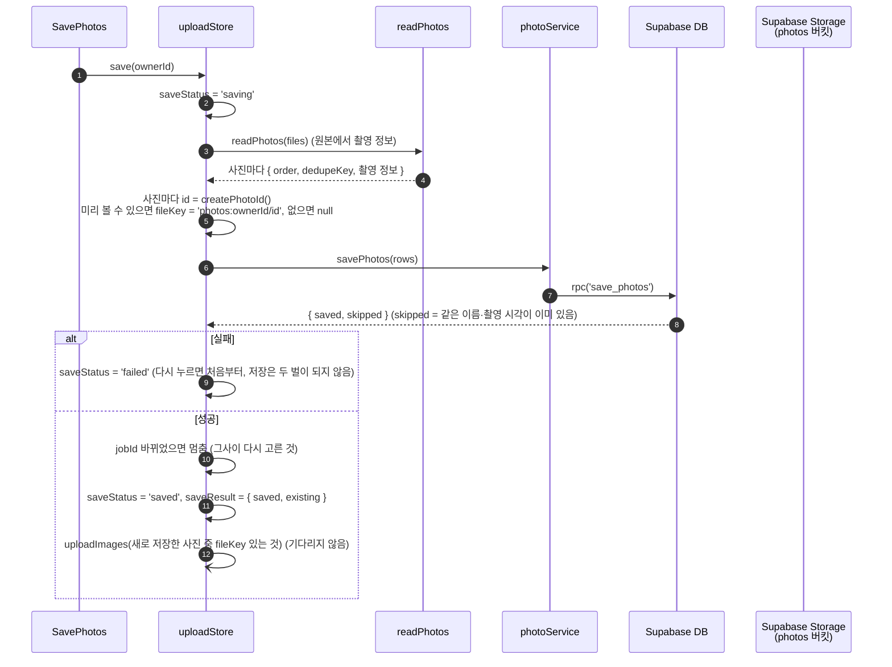
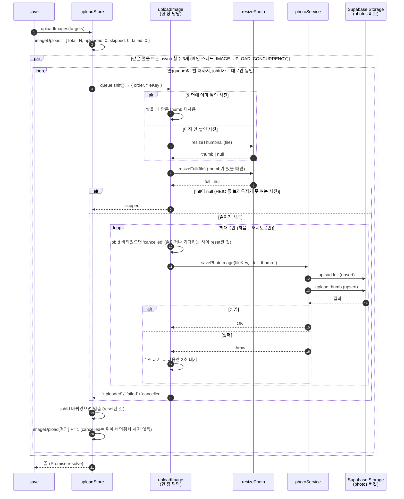
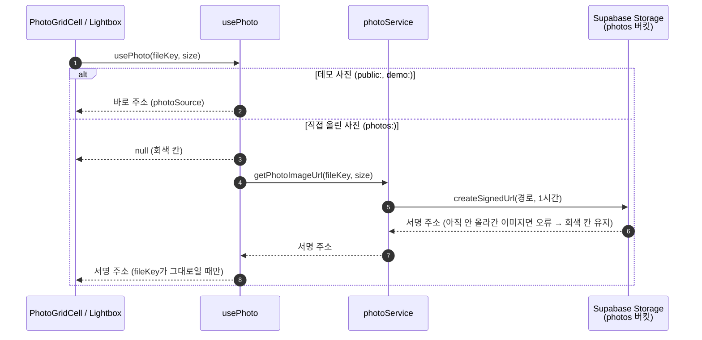
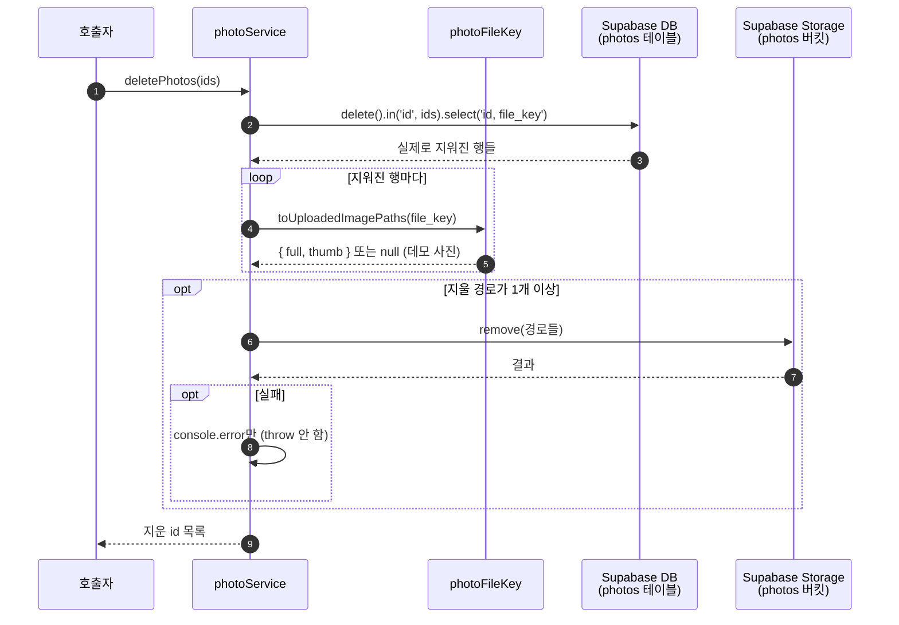

# 사진 저장·이미지 올리기·보기·지우기 흐름 (#26)

## 한눈에

```
저장:    [저장하기] → 촬영 정보 읽기 → DB에 저장 → 올릴 사진 골라 올리기 시작
올리기:  보기용으로 줄임 → 버킷에 올림 (3장씩, 실패하면 다시)
보기:    'photos:' 키는 서명 주소를 받아 와서 보여 줌 (받기 전엔 회색 칸)
지우기:  DB에서 지움 → 버킷 파일도 지움
키:      DB엔 'photos:내id/사진id' 하나만 적고, 실제 파일 경로는 필요할 때 계산
```

아래 다이어그램은 이 줄기에 재시도·취소·건너뛰기 같은 예외 처리를 더한 것입니다.

저장 버튼과 진행 줄은 03 화면과 #27이 생기기 전까지 모으기 화면(`SavePhotos`)에 임시로 둡니다.

## 1. 저장 (`save`)

같은 폴더를 다시 넣어도 두 벌로 저장되지 않습니다. 이미 저장한 사진의 이미지는 다시 올리지 않습니다.
창을 닫으면 JS가 멈추면서 올리기도 멈춥니다. 그때 못 올린 이미지를 이어서 올리는 기능은 #26에 남겨 두었습니다(코드가 커서 뺐음).



## 2. 올리기 (`uploadImages`)



## 3. 보기 (`usePhoto`)



## 4. 지우기 (`deletePhotos`)


