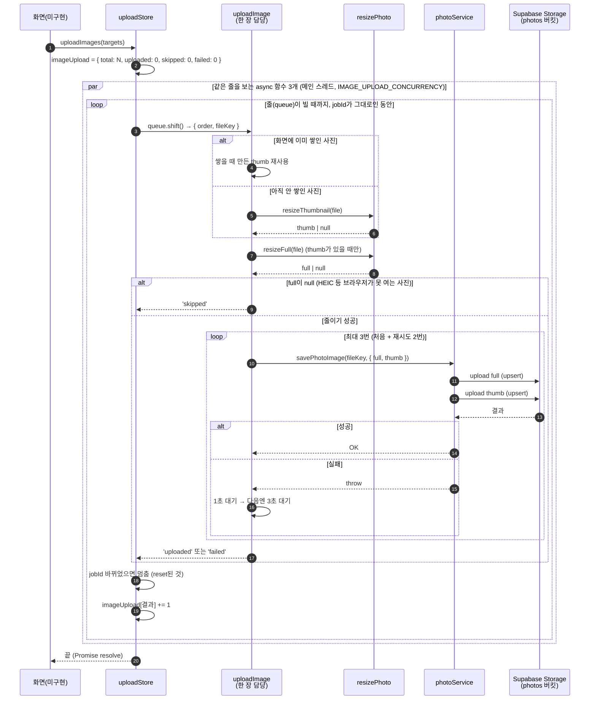
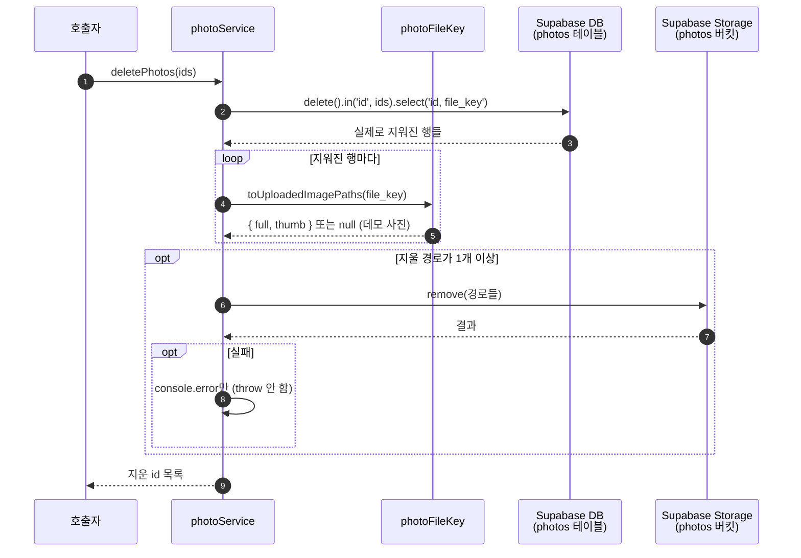

# 사진 이미지 올리기·지우기 흐름 (#26)

## 한눈에

```
올리기:  사진 고름 → 보기용으로 줄임 → 버킷에 올림 (3장씩, 실패하면 다시)
지우기:  DB에서 지움 → 버킷 파일도 지움
키:      DB엔 'photos:내id/사진id' 하나만 적고, 실제 파일 경로는 필요할 때 계산
```

아래 다이어그램은 이 줄기에 재시도·취소·건너뛰기 같은 예외 처리를 더한 것입니다.

`uploadImages`를 부르는 화면은 아직 없어서, "화면"은 앞으로 붙을 호출자입니다.

## 1. 올리기 (`uploadImages`)



## 2. 지우기 (`deletePhotos`)


