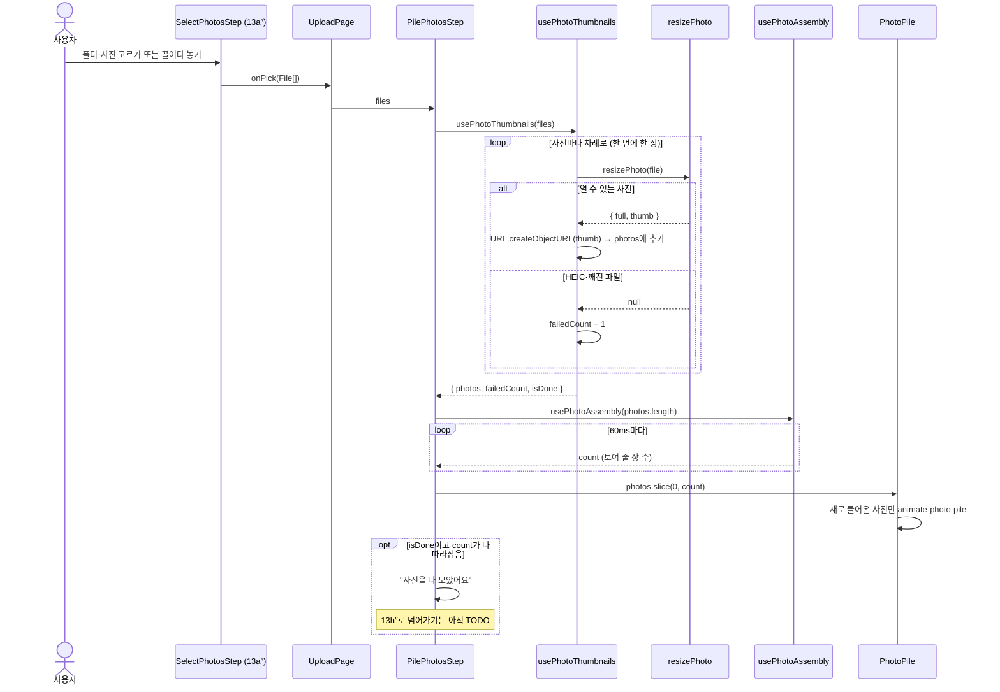

# 사진 쌓기 흐름 (#87)

13a″에서 사진을 고르면 13h″ 지나가며 정리로 가기 전에, 고른 사진이 폴라로이드처럼 하나씩 포개지며 쌓이는 화면을 거칩니다. 예전 안의 13b″(읽으면서 미리보기)·13c″(다 읽음)는 없애고 이 화면 하나로 대신합니다(#23·#25 닫음).

```
13a″ 고르기 → 사진 쌓기(#87) → 13h″~13k″ 지나가며 정리 → 13d″ 03이 채워짐
```

## 파일

| 파일                                  | 하는 일                                                                     |
| ------------------------------------- | --------------------------------------------------------------------------- |
| `pages/UploadPage/UploadPage.jsx`     | 고른 사진이 없으면 `SelectPhotosStep`(13a″), 있으면 `PilePhotosStep`을 그림 |
| `pages/UploadPage/PilePhotosStep.jsx` | 두 훅을 이어 붙이고 `N / 전체장`·제목·건너뛴 수를 보여 줌                   |
| `pages/UploadPage/PhotoPile.jsx`      | 받은 사진을 위치·각도를 조금씩 바꿔 겹쳐 그림                               |
| `hooks/upload/usePhotoThumbnails.js`  | `resizePhoto`로 한 장씩 썸네일을 만들어 `PilePhoto[]`로 돌려줌              |
| `hooks/upload/usePhotoAssembly.js`    | 준비된 사진 중 지금 몇 장을 보여 줄지 셈                                    |
| `styles/tokens.css`                   | `animate-photo-pile` (사진이 더미에 내려앉는 움직임)                        |
| `types.js`                            | `PilePhoto` = `{ id, filename, src }`                                       |

## 흐름



## 코드만 봐서는 알기 어려운 것

- **한 장씩 차례로 줄이는 이유**: `createImageBitmap`은 사진을 픽셀로 풀어 메모리에 올립니다. 4000×3000 사진 한 장이 약 48MB라, 수백 장을 동시에 풀면 탭이 멈출 수 있습니다.
- **썸네일 준비와 보여 주기를 나눈 이유**: 작은 사진은 순식간에 여러 장이 준비돼서, 준비되는 대로 그리면 더미가 한 번에 생겨 쌓이는 느낌이 없습니다. `usePhotoAssembly`가 60ms마다 한 장씩 늘리고, 많이 밀리면 남은 수의 1%씩 한 번에 따라잡습니다.
- **움직임 줄이기**: `prefers-reduced-motion`이 켜져 있으면 기다리지 않고 준비된 사진을 바로 다 보여 주고, 내려앉는 움직임도 끕니다(`motion-safe:`).
- **위치를 무작위로 정하지 않는 이유**: 다시 그릴 때마다 사진이 튀지 않도록 순서(index)로 `sin`·`cos` 값을 구해 위치·각도를 정합니다. 같은 순서면 항상 같은 자리입니다.
- **`--pile-*` 변수를 쓰는 이유**: 애니메이션의 `transform`이 인라인 `transform`을 덮어씁니다. 그래서 놓일 자리를 CSS 변수로 넘겨 keyframes 시작·끝에서 같은 자리를 쓰게 했습니다.
- **크기를 `cqw`로 적은 이유**: 더미 상자(`@container`) 폭을 기준으로 카드 크기와 흩어진 거리가 같이 줄어들어, 화면 폭이 바뀌어도 모양이 같습니다.
- **blob: 주소 해제**: 화면이 사라지면 남은 사진은 줄이지 않고, 만든 주소를 모두 `URL.revokeObjectURL`로 풀어 메모리를 돌려줍니다.
- **files는 같은 배열이어야 합니다**: `usePhotoThumbnails`는 `files`가 바뀌면 처음부터 다시 줄입니다. 새 사진 묶음으로 바꿀 때는 쓰는 쪽에서 `key`를 바꿔 새로 그려 주세요.
- **"N / 전체장"의 N**: 줄인 수가 아니라 지금 더미에 보이는 수입니다. 전체는 고른 파일 수라서, 건너뛴 사진이 있으면 다 모아도 N이 전체보다 작습니다.

## 아직 안 한 것

- 다 쌓인 뒤 13h″로 넘어가기 (13h″ 이슈가 생기면 연결)
- 캡션에 촬영 시각 붙이기 (readPhotos #22. EXIF는 줄이기 전에 원본에서 읽어야 함)
- `resizePhoto`가 썸네일만 필요해도 2048px 보기용까지 만듦. 썸네일을 먼저 넘길지는 #26에서 정함
