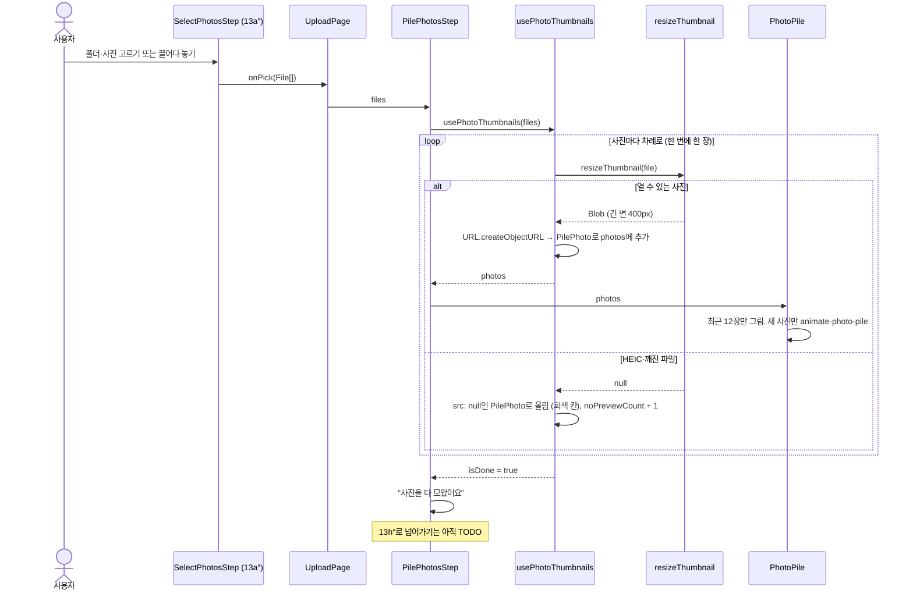

# 사진 쌓기 흐름 (#87)

13a″에서 사진을 고르면 13h″ 지나가며 정리로 가기 전에, 고른 사진이 폴라로이드처럼 하나씩 포개지며 쌓이는 화면을 거칩니다. 예전 안의 13b″(읽으면서 미리보기)·13c″(다 읽음)는 없애고 이 화면 하나로 대신합니다(#23·#25 닫음).

```
13a″ 고르기 → 사진 쌓기(#87) → 13h″~13k″ 지나가며 정리 → 13d″ 03이 채워짐
```

## 파일

| 파일                                  | 하는 일                                                                     |
| ------------------------------------- | --------------------------------------------------------------------------- |
| `pages/UploadPage/UploadPage.jsx`     | 고른 사진이 없으면 `SelectPhotosStep`(13a″), 있으면 `PilePhotosStep`을 그림 |
| `pages/UploadPage/PilePhotosStep.jsx` | `N / 전체장`·제목·미리 볼 수 없는 수를 보여 주고 더미를 그림                |
| `pages/UploadPage/PhotoPile.jsx`      | 받은 사진 중 최근 12장을 위치·각도를 조금씩 바꿔 겹쳐 그림                  |
| `hooks/upload/usePhotoThumbnails.js`  | 한 장씩 썸네일로 줄여 `PilePhoto`로 올리고, blob: 주소를 만들고 해제함      |
| `utils/upload/resizePhoto.js`         | `resizeThumbnail` 추가: 400px 썸네일 한 장만 만듦                           |
| `styles/tokens.css`                   | `animate-photo-pile` (사진이 더미에 내려앉는 움직임)                        |
| `types.js`                            | `PilePhoto` = `{ id, order, filename, src }` (못 그린 사진은 `src: null`)   |

## 흐름



## 코드만 봐서는 알기 어려운 것

- **한 장씩 차례로 줄이는 이유**: `createImageBitmap`은 사진을 픽셀로 풀어 메모리에 올립니다. 4000×3000 사진 한 장이 약 48MB라, 수백 장을 동시에 풀면 탭이 멈출 수 있습니다.
- **썸네일만 만드는 이유(`resizeThumbnail`)**: `resizePhoto`는 2048px 보기용까지 만듭니다. 이 화면은 썸네일만 쓰는데 보기용을 만들고 버리면 사진 한 장에 가장 오래 걸리는 일을 헛되이 하게 됩니다. 샘플 40장(평균 327KB)에서 장당 약 111ms → 약 19ms로 줄었습니다.
- **일부러 늦추지 않는 이유**: 줄이는 대로 바로 올립니다. 처음엔 60ms마다 한 장씩 보여 주는 훅을 따로 뒀지만, 실제 사진은 그보다 느리게 줄어들어 하는 일이 없어서 뺐습니다. 휴대폰 원본(3~5MB)은 샘플보다 훨씬 느립니다.
- **최근 12장만 그리는 이유**: 겹쳐 있어서 위쪽 몇 장만 보입니다. 300장을 다 그리면 그림자 있는 요소 300개를 계속 다시 그립니다.
- **위치를 무작위로 정하지 않는 이유**: 다시 그릴 때마다 사진이 튀지 않도록 고른 순서(`photo.order`)로 `sin`·`cos` 값을 구해 위치·각도를 정합니다. map의 index를 쓰지 않는 건, 최근 12장만 자르면 index가 가리키는 사진이 계속 바뀌기 때문입니다.
- **움직임 줄이기**: `prefers-reduced-motion`이 켜져 있으면 CSS(`motion-safe:`)가 내려앉는 움직임을 끕니다. JS에서는 따로 보지 않습니다.
- **`--pile-*` 변수를 쓰는 이유**: 애니메이션의 `transform`이 인라인 `transform`을 덮어씁니다. 그래서 놓일 자리를 CSS 변수로 넘겨 keyframes 시작·끝에서 같은 자리를 쓰게 했습니다.
- **크기를 `cqw`로 적은 이유**: 더미 상자(`@container`) 폭을 기준으로 카드 크기와 흩어진 거리가 같이 줄어들어, 화면 폭이 바뀌어도 모양이 같습니다.
- **blob: 주소 해제**: 주소를 만드는 곳과 해제하는 곳을 `usePhotoThumbnails` 한 곳에 뒀습니다. 화면이 사라지면 남은 사진은 줄이지 않고, 만든 주소를 모두 `URL.revokeObjectURL`로 풀어 줍니다.
- **files가 바뀌면 처음부터**: `usePhotoThumbnails`는 상태에 `files`를 같이 기억해 두고, 다른 배열이 오면 그리는 도중에 이전 사진·수를 비우고 처음부터 다시 줄입니다(React 문서의 "props가 바뀌면 state 맞추기"). 그래서 쓰는 쪽은 그릴 때마다 새 배열을 만들지 말고 같은 배열을 넘겨야 합니다. [다시 고르기]는 화면을 아예 새로 그려서 이 경우가 아닙니다.
- **"N / 전체장"**: N은 더미에 올린 수, 전체는 고른 파일 수입니다. 브라우저가 못 그리는 사진(Chrome·Windows의 HEIC, 깨진 파일)도 버리지 않고 회색 칸으로 올려서 다 모으면 N = 전체입니다. HEIC는 그림만 못 그릴 뿐 촬영 정보는 읽을 수 있는 사진이라서 버리면 안 됩니다(`constants/upload.js`). 진짜 깨진 파일은 다음 단계(readExif)가 거릅니다.

- **화면 읽기 프로그램 알림**: 숫자(`N / 전체장`)에는 `role="status"`를 달지 않습니다. 사진마다 바뀌어서 300장이면 300번 읽기 때문입니다. 대신 화면에 안 보이는(`sr-only`) `role="status"` 문구를 비워 두었다가, 다 모았을 때 한 번만 "사진 N장을 다 모았어요"로 채웁니다. live 영역은 내용이 바뀔 때 읽어서 처음부터 글자가 있으면 읽지 않는 브라우저가 있습니다.
- **캡션 크기 `max(10px, 2.29cqw)`**: 카드처럼 상자 폭을 따라갑니다. 2.29cqw는 13a″ `PolaroidStack`과 같은 값(상자 480px일 때 11px)입니다. `PolaroidStack`은 휴대폰에서 숨지만 이 더미는 보여서 10px 아래로는 안 줄입니다.

## 아직 안 한 것

- 다 쌓인 뒤 13h″로 넘어가기 (13h″ 이슈가 생기면 연결)
- 캡션에 촬영 시각 붙이기 (readPhotos #22. EXIF는 줄이기 전에 원본에서 읽어야 함)
